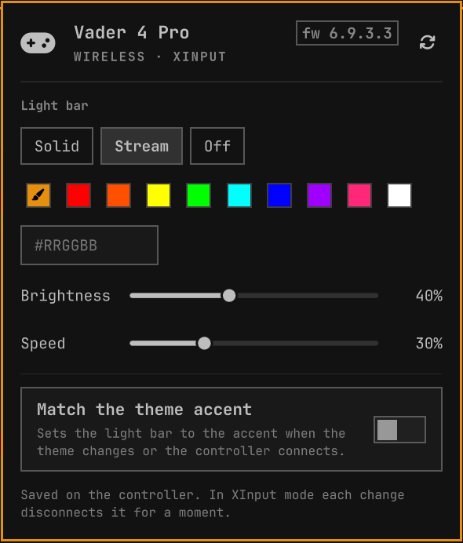

# Flydigi Vader 4 for Omarchy



An Omarchy bar widget for the light bar on a Flydigi Vader 4 Pro. Click the controller icon to pick a solid color, the factory stream effect, or off, and to set the brightness and stream speed. It can also keep the light bar matched to your theme's accent color.

The settings are saved on the controller, so they stay when you plug it into another machine.

The icon shows up when the controller is connected and hides when it is unplugged. The plugin learns about hotplug from udev, so it never polls.

## Requirements

- Omarchy 4 (the Quattro shell).
- A Flydigi Vader 4 Pro in **XInput** mode (hold the circle button and X until the indicator is white) or **DInput** mode (circle and A, blue indicator), connected by USB or the 2.4 GHz dongle. Switch mode and Bluetooth don't use this protocol.
- Go, to build the helper. `install.sh` installs it with pacman if it is missing.

## Install

```sh
omarchy plugin add https://github.com/z23/omarchy-flydigi.git
~/.config/omarchy/plugins/io.github.z23.flydigi/install.sh
omarchy plugin enable io.github.z23.flydigi
```

`omarchy plugin add` only clones the repository, so the helper and the udev rule need `install.sh`. It does three things:

1. Builds `vader4-rgb` from `helper/` into a temporary folder and installs it as `~/.local/bin/vader4-rgb`. It is a static Go binary with no cgo and no libusb. An older `vader4-rgb` from z23/flydigictl in the same place is kept as `vader4-rgb.old`.
2. Installs `udev/60-flydigi.rules` to `/etc/udev/rules.d/` with sudo, then reloads udev. The rule gives the logged-in user access to the controller. Skip it with `--no-udev`.
3. Tells a running shell to look for the helper again.

The plugin runs inside `omarchy-shell` with your user's permissions, like every Omarchy plugin. It never asks for sudo; only `install.sh` and `uninstall.sh` do, for the udev rule.

If the panel still says permission is needed after `install.sh`, unplug the controller and plug it back in.

## Using it

Left click the icon to open the panel:

- **Solid, Stream, Off** choose the effect.
- The swatches are the theme accent (brush icon) and the named colors `vader4-rgb` knows. Type any `#RRGGBB` into the field and press Enter for another color.
- **Brightness** and, for Stream, **Speed** apply when you let go of the slider.
- **Match the theme accent** sets the light bar to the accent whenever the theme changes or the controller connects.
- The refresh button, or R, reads the lighting back from the controller.

The two settings are also in the widget's settings and on the command line:

```sh
omarchy bar set io.github.z23.flydigi followTheme On
omarchy bar set io.github.z23.flydigi showWhenDisconnected On
```

The widget registers the IPC target `io.github.z23.flydigi`, so you can bind keys to it:

```sh
omarchy-shell io.github.z23.flydigi toggle            # open or close the panel
omarchy-shell io.github.z23.flydigi color '#00e5ff'
omarchy-shell io.github.z23.flydigi off
omarchy-shell io.github.z23.flydigi stream
omarchy-shell io.github.z23.flydigi refresh           # read the controller
omarchy-shell io.github.z23.flydigi state             # what the plugin knows, as JSON
```

### XInput and DInput

In **XInput** mode, the settings channel is the gamepad interface itself, so the kernel's `xpad` driver has to let go of the controller while `vader4-rgb` talks to it. Games see the controller disconnect and reconnect during each read or change.

In **DInput** mode, the settings channel is a separate HID interface, so the gamepad should keep its driver. DInput has been checked against golden packets from the original implementation but not yet on a controller; XInput has been tested on a Vader 4 Pro (firmware 6.9.3.3) over the 2.4 GHz dongle.

The plugin only talks to the controller when one of these happens:

- you change something;
- you press refresh;
- you open the panel and no lighting is on record yet;
- theme following is on, and the accent and the light bar differ.

Otherwise it shows the last lighting from `~/.local/state/vader4-rgb/state.json`. A change made with `vader4-rgb` in a terminal shows up in the bar too.

## The helper on its own

`vader4-rgb` works without the plugin, and its commands match the older `vader4-rgb` from z23/flydigictl:

```
vader4-rgb                  show the controller and its lighting
vader4-rgb cyan             solid color
vader4-rgb '#00e5ff' -b 70  solid color at brightness 0 to 100
vader4-rgb off              light bar off
vader4-rgb stream -s 0.5    factory moving effect, speed 0 to 1
vader4-rgb -b 40            brightness only
vader4-rgb status           is a controller connected and can this user open it (never opens it)
vader4-rgb watch            the same as JSON lines, now and on every change
```

Add `--json` for machine-readable output, or `--debug` to print protocol packets. The exit status tells failures apart:

| Status | Meaning |
|---|---|
| 0 | done |
| 1 | failed |
| 2 | usage error |
| 3 | no controller |
| 4 | no permission |
| 5 | busy |
| 6 | the controller did not answer |

Colors are `#RRGGBB`, `RRGGBB`, `#RGB`, or one of these names: red, green, blue, white, cyan, magenta, yellow, orange, purple, pink, black.

## Uninstall

```sh
~/.config/omarchy/plugins/io.github.z23.flydigi/uninstall.sh
omarchy plugin remove io.github.z23.flydigi
```

`uninstall.sh` removes the helper, its state file, and the udev rule. It also puts back a `vader4-rgb.old` that `install.sh` set aside. Run it first, because `omarchy plugin remove` deletes the folder and never runs anything from it.

## How it works

- **`Service.qml`** has one instance for the whole shell. It runs every `vader4-rgb` command, so bars on several monitors never talk to the controller at once. Changes made while one is running are merged into a single write.
- **`vader4-rgb watch`** reads sysfs, never the controller. It listens for udev events on a netlink socket, so the plugin learns about hotplug and permission changes without polling.
- **The state file**, `state.json`, is watched with `FileView`.
- **`BarWidget.qml`** is the icon and hosts `Panel.qml`. **`Model.js`** holds the pure logic, which is tested under node.
- **The helper** talks to the controller through Linux usbfs ioctls in XInput mode and hidraw in DInput mode. It holds a lock in `$XDG_RUNTIME_DIR` so two copies never interleave packets. It also finishes a write it has started even if asked to stop, so the controller never keeps half a lighting block.

## Development

```sh
(cd helper && go test ./...)
node --test tests/model.test.mjs
omarchy plugin validate .
```

`helper/internal/vader/testdata/golden.json` comes from the pipe01/flydigictl implementation this helper replaces. The tests check that the rewrite sends the same bytes.

After you change QML, restart the shell with `omarchy-restart-shell`. In this shell version a hot reload can keep the previous compiled component.

## License

GPL-3.0-only; see [LICENSE](LICENSE). The protocol work comes from [pipe01/flydigictl](https://github.com/pipe01/flydigictl) by Felipe Martínez, by way of [z23/flydigictl](https://github.com/z23/flydigictl). This project is not affiliated with Flydigi.

THIS PROGRAM IS PROVIDED AS-IS AND MAKES NO EXPRESS OR IMPLIED WARRANTY OF ANY KIND. THE AUTHORS ARE NOT RESPONSIBLE FOR ANY DAMAGE TO THE DEVICE OR ITS ACCESSORIES.
